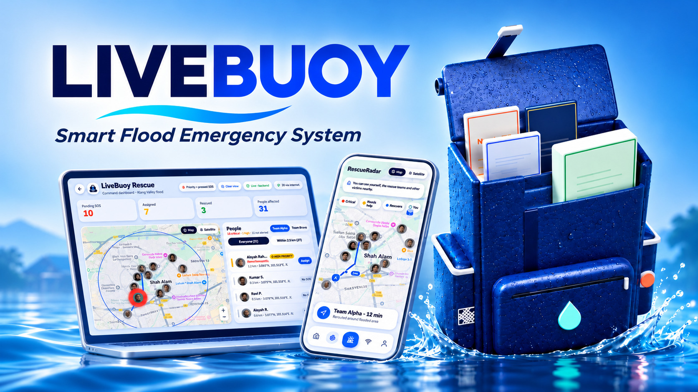

<div align="center">

# LiveBuoy

### *Your lifeline in floods.*
*Protect what matters. Stay connected when it matters most.*


[](https://livebuoy.onrender.com/)
[](https://youtu.be/eWgFkD17qo4?si=N60784GksrdQphFk)



**A waterproof backpack that keeps your documents dry and sends your SOS even when the phone network is down.**

*Team Chikwa · STC x Kiro Mini Hackathon 2026 · Track: Disaster Recovery*

</div>

---

## Problem

**Flood rescuers struggle to locate flood victims because conditions during a flood are chaotic.**

Meet **Pn Aisyah, 70, Kelantan**: no phone signal, her documents are wet, and the rescue team is asking *"Where is she?"*

| | What goes wrong |
|---|---|
| **Documents are lost** | IC, passport and medical records are destroyed or left behind in a rushed evacuation. |
| **Communication breaks** | Cell towers and internet fail, so people can't call for help or share where they are. |
| **Rescuers are blind** | Rescue teams can't see who needs help or where they are. |

**The scale of it**

| | |
|---|---|
| **~500 M** | people affected by floods per year |
| **29.4%** | of flood victims lose personal documents |
| **323** | telecommunication towers knocked offline in the late 2024 floods |

## Target users

- **People living in high-risk flood areas of Malaysia**, such as Klang Valley, Kelantan, Terengganu, Pahang and Sabah/Sarawak river communities. Households in mixed communities, including elderly residents and families with children.
- **Rescuers and coordinators:** APM, Bomba, NADMA, state agencies and NGO volunteer teams who need to find victims fast.

## Solution

**LiveBuoy is a 2-in-1 solution: a floating, waterproof backpack (LivePack) with a built-in offline SOS beacon (FloodMesh), paired with a platform and dashboard that shows every victim and rescuer in one place.**

### How it works

| Prepare | Trigger | Relay | Respond |
|---|---|---|---|
| Receive a flood alert through verified portals. Pack documents in the LivePack. Tie it to your info via the app. | On evacuation, turn on FloodMesh. Long press for an emergency priority call. | Broadcast location continuously over the internet or p2p Bluetooth. Phone and LivePack can both send signals. | Dashboard shows live victim locations. Rescue teams mark victims to save. Two-way signals between rescuer and victim. |

## Features

### The backpack (LivePack)
- **Waterproof, sealed roll-top** with organised compartments for IC, passport, certificates, medical records and cash.
- **Built-in FloodMesh beacon** in the front pocket: a chip with its own **swappable battery**, a physical SOS button, and a QR/NFC tag that holds privacy-protected emergency info.
- **LastSignal:** when the battery runs low, the beacon and phone send one final alert with the last known location before shutting down.

### Victim app (mobile)
- **Backpack checklist:** every item that should be packed, with its details.
- **Manual SOS:** tap once, with a 3-second cancel window so an accidental tap won't call rescuers. Pick a **reason**, which sets the alert **priority**, and **all your data** (identity, medical info, live location, battery, bag ID, contacts) is sent together.
- **Automatic routing:** it detects whether the phone really has internet. If so, the SOS goes over Wi-Fi/data. If not, it relays peer-to-peer through **FloodMesh**.
- **Connectivity check:** a one-screen test of network, rescue server, beacon, GPS and mesh relays.
- **LastSignal demo:** simulate a dying battery and watch the phone send its final alert at 5%, then power off.
- **Rescue Radar** and a profile with emergency contacts and hidden-by-default medical info.

### Rescuer dashboard (desktop)
- **Live map** (Google Maps with a **Satellite** toggle) showing every victim with a photo, severity colour and heat glow, plus rescue teams and the route.
- **"Victims near you":** pick a team, see a 2.5 km radius, and list victims sorted by distance with how each SOS arrived (internet or mesh).
- **Reason and LastSignal tags** on each alert, and one-click **Assign → Rescued** status tracking.
- A live SOS sent from the phone app appears on the dashboard instantly.

### 3D showcase (`/`)
- Full-screen, interactive **3D backpack** you can spin, open, and explore item by item, including the built-in beacon with a battery swap animation.
- **Water test:** the sea rises and the bag floats on the flood with its owner holding it.

## Tech stack

| Layer | Tech |
|---|---|
| Frontend | Next.js 16 (App Router), React 19, TypeScript, Tailwind CSS v4 |
| 3D demo | three.js, React Three Fiber, drei, custom GLSL ocean (Gerstner waves) |
| Maps | Google Maps JavaScript API (`@vis.gl/react-google-maps`) with an offline SVG fallback |
| Backend | FastAPI + Uvicorn + Pydantic, Supabase Postgres (see [`backend/AGENTS.md`](backend/AGENTS.md)) |
| Deployment | Docker, Render |
| Connectivity | Online/offline detection with a real server-reachability check, falling back to peer-to-peer FloodMesh relay |
| Hardware (prototype plan) | Battery-powered beacon with short-range radio and GNSS, QR/NFC tag |

## Competitor analysis

LiveBuoy is the only everyday safety bag that sends offline SOS alerts and creates two-way visibility between victims and rescuers.

| | SOS beacon | Victim–rescuer signals | Offline live location | Emergency bag |
|---|:-:|:-:|:-:|:-:|
| Gov flood apps (MyDIMS) | ✗ | ✗ | ✗ | ✗ |
| Bridgefy (mesh app) | ✗ | ✓ | ✗ | ✗ |
| Garmin inReach | ✓ | ✓ | ✓ | ✗ |
| Ushahidi | ✗ | ✓ | ✗ | ✗ |
| Ukuran (emergency bag) | ✗ | ✗ | ✗ | ✓ |
| **LiveBuoy** | ✓ | ✓ | ✓ | ✓ |

## Business value

*These are our working hypotheses, not measured results.*

- **Everyday product, not a crisis-day download.** A useful, durable backpack gives people a reason to prepare *before* the flood, which is when apps fail to get installed.
- **Revenue streams:** backpack sales, a beacon-module subscription for the mesh and dashboard service, and bulk supply to government and NGOs.
- **Institutional buyers:** state and national disaster agencies, local councils, and NGOs get a dashboard that shows who needs help and where, without relying on cell coverage.
- **Partnerships:** insurers and employers (CSR and employee safety) can fund or subsidise bags for high-risk households.
- **Network effect:** every backpack and phone becomes a mesh relay, so coverage improves as more people carry one.

## Impact

- **Less document loss (target: 80%):** people keep proof of identity and medical history, which speeds up relief and reduces recovery costs.
- **SOS delivery success:** offline SOS communication keeps working when networks fail.
- **Faster rescue response:** faster victim detection and coordination. The SOS arrives with the reason, medical info and exact location, so rescuers can **prioritise the most critical cases first**.
- **No dead end when the battery dies:** LastSignal gets one final location out.
- **Better coordination:** rescuers see all victims, distances and status on one map instead of piecing together phone calls.

### Limits we're honest about
- Mesh delivery needs a relay path or gateway in range; coverage depends on how many devices are nearby.
- A water-resistant bag isn't automatically submersion-proof. It needs real immersion testing before any rating is claimed.
- Routes depend on the accuracy of flood data and can't guarantee safe passage.
- The mesh, beacon and backend integration are currently **simulated in the demo**.

## Run it

```bash
# 1. Backend (FastAPI + Supabase Postgres). Put DATABASE_URL=... in backend/.env (git-ignored)
cd backend && python3 -m venv .venv && .venv/bin/pip install -r requirements.txt
.venv/bin/uvicorn main:app --reload --port 8000 --env-file .env
.venv/bin/python seed.py            # optional: 10 demo victims, sent through the API

# 2. Frontend
cd frontend && npm install && npm run dev        # http://localhost:3000
```

# 3. Env
Add in the relevant keys, one from Supabase in backend/.env and one in Frontend as .env.local with the Google maps key as shown in example.


The app talks to `http://localhost:8000` (override with `NEXT_PUBLIC_API_URL`). If the backend is down, the dashboard falls back to built-in demo data and says so, and the phone app sends SOS over the simulated mesh instead.

Optional frontend variable (in git-ignored `frontend/.env.local`): `NEXT_PUBLIC_GOOGLE_MAPS_KEY` for the real map; without it an offline map is shown.

| Route | What it is |
|---|---|
| `/` | Full-screen 3D backpack and water test |
| `/app` | Mobile app: backpack checklist |
| `/radar`, `/sos`, `/connect`, `/profile` | Mobile app tabs |
| `/admin` | Rescuer dashboard |

## Repository layout

```
frontend/   Next.js app (3D bag, mobile app, rescuer dashboard)
backend/    FastAPI service (one folder; see backend/AGENTS.md)
docs/       README assets
scripts/    helper scripts (e.g. cropping profile photos)
```
